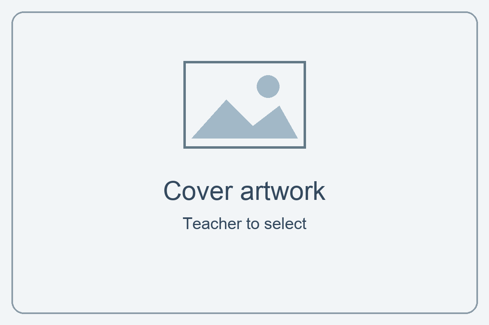

:::: layout-cover
::: cover-name
Student  
Name: ........................................
:::

::: cover-qualification
Level 1  
Ascentis Progression
:::

::: cover-code
Unit R/505/6389
:::

::: cover-title
# Design Software
:::

::: cover-artwork
{width="9cm"}
:::
::::

::: layout-cover-dates
| Issue Date | Hand in Date | IV Date | Teacher Name |
| :---: | :---: | :---: | :---: |
| | | | |
:::

::: layout-page-break
:::

## Learning Outcomes and Assessment Criteria

In order to pass this unit, the evidence that the learner presents for assessment needs to demonstrate that they can meet all the learning outcomes for the unit. The assessment criteria determine the standard required to achieve the unit.

::: layout-assessment-criteria
+---------------------------------------+---------------------------------------------------------------+
| Learning Outcome (The learner will:)  | Assessment Criteria (The learner can:)                        |
+=======================================+===============================================================+
| **1. Be able to obtain, insert and    | 1.1 Identify what designs are needed.                         |
| combine information for designs.**    |                                                               |
|                                       | 1.2 Obtain, input and prepare designs to meet requirements.   |
|                                       |                                                               |
|                                       | 1.3 Identify the main copyright and other constraints which   |
|                                       | apply to the use of designs.                                  |
|                                       |                                                               |
|                                       | 1.4 Combine information of two different types or from two    |
|                                       | different sources for designs.                                |
|                                       |                                                               |
|                                       | 1.5 Identify how the designs will be used.                    |
|                                       |                                                               |
|                                       | 1.6 Identify which file format to use for saving and          |
|                                       | exchanging designs.                                           |
|                                       |                                                               |
|                                       | 1.7 Store and retrieve files appropriately, in line with      |
|                                       | local guidelines and conventions where available.             |
+---------------------------------------+---------------------------------------------------------------+
| **2. Be able to use design software   | 2.1 Use suitable tools and techniques to create designs.      |
| tools to create, manipulate and edit  |                                                               |
| designs.**                            | 2.2 Use appropriate tools and techniques to manipulate and    |
|                                       | edit designs.                                                 |
|                                       |                                                               |
|                                       | 2.3 Check designs meet requirements, using IT tools and       |
|                                       | making corrections as necessary.                              |
+---------------------------------------+---------------------------------------------------------------+

:::

::: layout-page-break
:::

## Your project: Design a canteen app

Unit R/505/6389 · Level 1 · 3 credits

### Your aim

Collect information, create and edit a design for an audience, then check and improve it.

### Your brief

Make a canteen ordering app with your own menu and visual design. It is a classroom simulation: no real orders or payments are sent.

### Include in your project

- At least 10 researched items: 4 mains, 3 snacks/desserts, 3 drinks; at least 3 healthy choices across the menu.
- Descriptions, prices, local images, health/allergen information and sources.
- An audience, mood board and labelled wireframe.
- Your own layout, text and style choices, including a direct CSS edit.
- A JavaScript activity attempt and a short learning record.
- Checks, useful corrections, organised files and Git checkpoints.

You can use supplied working functions. You do not need to finish every programming challenge or the optional discount to evidence the unit criteria.

### Start and get help

Start with Guide 1 for setup and planning, then Guide 2 and Guide 3. Use the Save/test guide for checking and hand-in.

Open the [project hub](../l1-design-software-student/index.html) for the starter, Diner and Riot Bites examples, and all four guides. The guides teach the skills. This booklet records your evidence. Use short notes and clear screenshots. Your teacher can record a demonstration where appropriate.

::: layout-page-break
:::

## Task 1: What does your design need?

Assessment criterion: 1.1. Use Guide 1, Step 1.

Explore the starter. Choose your audience and eight needed features. Think about browsing, choosing, reading and checking an order.

::: {.layout-textbox height="3.5cm" title="Who will use my app?"}

:::
+-------+---------------------------------------------------------------------------------------+
| No.   | Feature / visual element                                                              |
+=======+=======================================================================================+
| 1     |                                                                                       |
+-------+---------------------------------------------------------------------------------------+
| 2     |                                                                                       |
+-------+---------------------------------------------------------------------------------------+
| 3     |                                                                                       |
+-------+---------------------------------------------------------------------------------------+
| 4     |                                                                                       |
+-------+---------------------------------------------------------------------------------------+
| 5     |                                                                                       |
+-------+---------------------------------------------------------------------------------------+
| 6     |                                                                                       |
+-------+---------------------------------------------------------------------------------------+
| 7     |                                                                                       |
+-------+---------------------------------------------------------------------------------------+
| 8     |                                                                                       |
+-------+---------------------------------------------------------------------------------------+

::: {.layout-textbox height="3.5cm" title="Two choices and why they matter"}
Pick two features from your list. Explain how they help your audience.
:::

::: layout-page-break
:::

## Task 2: Where will it be used?

Assessment criterion: 1.5. Use Guide 1, Step 1.

::: {.layout-textbox height="3.5cm" title="Device and place"}
Choose a device and place, such as a tablet at a canteen counter.
:::

::: {.layout-textbox height="3.5cm" title="Design choice 1 and how it helps"}

:::

::: {.layout-textbox height="3.5cm" title="Design choice 2 and how it helps"}

:::

::: layout-page-break
:::

## Task 3: Menu research — Mains

Assessment criterion: 1.2. Use Guide 1, Step 2.

Include at least three healthy choices across the full menu. Record source pages or packaging references. You can add extra records if needed.

### Item 1

+----------------------------------------------------------+-----------------------------------------+
| Name / short description                                 | Price / healthy? / allergens            |
+==========================================================+=========================================+
|                                                          |                                         |
+----------------------------------------------------------+-----------------------------------------+
| Source(s) for food information and price:                |                                         |
+----------------------------------------------------------+-----------------------------------------+

### Item 2

+----------------------------------------------------------+-----------------------------------------+
| Name / short description                                 | Price / healthy? / allergens            |
+==========================================================+=========================================+
|                                                          |                                         |
+----------------------------------------------------------+-----------------------------------------+
| Source(s) for food information and price:                |                                         |
+----------------------------------------------------------+-----------------------------------------+

### Item 3

+----------------------------------------------------------+-----------------------------------------+
| Name / short description                                 | Price / healthy? / allergens            |
+==========================================================+=========================================+
|                                                          |                                         |
+----------------------------------------------------------+-----------------------------------------+
| Source(s) for food information and price:                |                                         |
+----------------------------------------------------------+-----------------------------------------+

### Item 4

+----------------------------------------------------------+-----------------------------------------+
| Name / short description                                 | Price / healthy? / allergens            |
+==========================================================+=========================================+
|                                                          |                                         |
+----------------------------------------------------------+-----------------------------------------+
| Source(s) for food information and price:                |                                         |
+----------------------------------------------------------+-----------------------------------------+

::: layout-page-break
:::

## Task 3: Menu research — Snacks / desserts

Assessment criterion: 1.2. Use Guide 1, Step 2.

Include at least three healthy choices across the full menu. Record source pages or packaging references. You can add extra records if needed.

### Item 5

+----------------------------------------------------------+-----------------------------------------+
| Name / short description                                 | Price / healthy? / allergens            |
+==========================================================+=========================================+
|                                                          |                                         |
+----------------------------------------------------------+-----------------------------------------+
| Source(s) for food information and price:                |                                         |
+----------------------------------------------------------+-----------------------------------------+

### Item 6

+----------------------------------------------------------+-----------------------------------------+
| Name / short description                                 | Price / healthy? / allergens            |
+==========================================================+=========================================+
|                                                          |                                         |
+----------------------------------------------------------+-----------------------------------------+
| Source(s) for food information and price:                |                                         |
+----------------------------------------------------------+-----------------------------------------+

### Item 7

+----------------------------------------------------------+-----------------------------------------+
| Name / short description                                 | Price / healthy? / allergens            |
+==========================================================+=========================================+
|                                                          |                                         |
+----------------------------------------------------------+-----------------------------------------+
| Source(s) for food information and price:                |                                         |
+----------------------------------------------------------+-----------------------------------------+

::: layout-page-break
:::

## Task 3: Menu research — Drinks

Assessment criterion: 1.2. Use Guide 1, Step 2.

Include at least three healthy choices across the full menu. Record source pages or packaging references. You can add extra records if needed.

### Item 8

+----------------------------------------------------------+-----------------------------------------+
| Name / short description                                 | Price / healthy? / allergens            |
+==========================================================+=========================================+
|                                                          |                                         |
+----------------------------------------------------------+-----------------------------------------+
| Source(s) for food information and price:                |                                         |
+----------------------------------------------------------+-----------------------------------------+

### Item 9

+----------------------------------------------------------+-----------------------------------------+
| Name / short description                                 | Price / healthy? / allergens            |
+==========================================================+=========================================+
|                                                          |                                         |
+----------------------------------------------------------+-----------------------------------------+
| Source(s) for food information and price:                |                                         |
+----------------------------------------------------------+-----------------------------------------+

### Item 10

+----------------------------------------------------------+-----------------------------------------+
| Name / short description                                 | Price / healthy? / allergens            |
+==========================================================+=========================================+
|                                                          |                                         |
+----------------------------------------------------------+-----------------------------------------+
| Source(s) for food information and price:                |                                         |
+----------------------------------------------------------+-----------------------------------------+

::: layout-page-break
:::

## Task 4: Image sources — items 1–5

Assessment criterion: 1.3. Use Guide 1, Step 2.

Record your local file, creator, source and reuse conditions. Include any required credit. Do not assume that finding an image means you can use it.

+---------+--------------------------------------+-------------------------------------------------------+
| Item    | Filename / creator                   | Source / permission / credit                          |
+=========+======================================+=======================================================+
| 1       |                                      |                                                       |
|         |                                      |                                                       |
| &nbsp;  | &nbsp;                               | &nbsp;                                                |
|         |                                      |                                                       |
| &nbsp;  | &nbsp;                               | &nbsp;                                                |
+---------+--------------------------------------+-------------------------------------------------------+
| 2       |                                      |                                                       |
|         |                                      |                                                       |
| &nbsp;  | &nbsp;                               | &nbsp;                                                |
|         |                                      |                                                       |
| &nbsp;  | &nbsp;                               | &nbsp;                                                |
+---------+--------------------------------------+-------------------------------------------------------+
| 3       |                                      |                                                       |
|         |                                      |                                                       |
| &nbsp;  | &nbsp;                               | &nbsp;                                                |
|         |                                      |                                                       |
| &nbsp;  | &nbsp;                               | &nbsp;                                                |
+---------+--------------------------------------+-------------------------------------------------------+
| 4       |                                      |                                                       |
|         |                                      |                                                       |
| &nbsp;  | &nbsp;                               | &nbsp;                                                |
|         |                                      |                                                       |
| &nbsp;  | &nbsp;                               | &nbsp;                                                |
+---------+--------------------------------------+-------------------------------------------------------+
| 5       |                                      |                                                       |
|         |                                      |                                                       |
| &nbsp;  | &nbsp;                               | &nbsp;                                                |
|         |                                      |                                                       |
| &nbsp;  | &nbsp;                               | &nbsp;                                                |
+---------+--------------------------------------+-------------------------------------------------------+

::: layout-page-break
:::

## Task 4: Image sources — items 6–10

Assessment criterion: 1.3. Use Guide 1, Step 2.

Record your local file, creator, source and reuse conditions. Include any required credit. Do not assume that finding an image means you can use it.

+---------+--------------------------------------+-------------------------------------------------------+
| Item    | Filename / creator                   | Source / permission / credit                          |
+=========+======================================+=======================================================+
| 6       |                                      |                                                       |
|         |                                      |                                                       |
| &nbsp;  | &nbsp;                               | &nbsp;                                                |
|         |                                      |                                                       |
| &nbsp;  | &nbsp;                               | &nbsp;                                                |
+---------+--------------------------------------+-------------------------------------------------------+
| 7       |                                      |                                                       |
|         |                                      |                                                       |
| &nbsp;  | &nbsp;                               | &nbsp;                                                |
|         |                                      |                                                       |
| &nbsp;  | &nbsp;                               | &nbsp;                                                |
+---------+--------------------------------------+-------------------------------------------------------+
| 8       |                                      |                                                       |
|         |                                      |                                                       |
| &nbsp;  | &nbsp;                               | &nbsp;                                                |
|         |                                      |                                                       |
| &nbsp;  | &nbsp;                               | &nbsp;                                                |
+---------+--------------------------------------+-------------------------------------------------------+
| 9       |                                      |                                                       |
|         |                                      |                                                       |
| &nbsp;  | &nbsp;                               | &nbsp;                                                |
|         |                                      |                                                       |
| &nbsp;  | &nbsp;                               | &nbsp;                                                |
+---------+--------------------------------------+-------------------------------------------------------+
| 10      |                                      |                                                       |
|         |                                      |                                                       |
| &nbsp;  | &nbsp;                               | &nbsp;                                                |
|         |                                      |                                                       |
| &nbsp;  | &nbsp;                               | &nbsp;                                                |
+---------+--------------------------------------+-------------------------------------------------------+

::: layout-page-break
:::

## Task 4 continued: Constraints

Assessment criterion: 1.3.

::: {.layout-textbox height="3.5cm" title="Copyright and permission"}
Why check permission? Explain the conditions for one image you chose.
:::

::: {.layout-textbox height="3.5cm" title="Another constraint"}
Name another limit, such as privacy or accuracy. What will you do about it?
:::

### Check your assets

Open each image from project/images/. Check its filename and extension match app.js. Keep source records available.

::: layout-page-break
:::

## Task 5: Combine information

Assessment criterion: 1.4. Use Guide 1, Step 4.

Show one menu card from your app. Keep text and price readable.

::: {.layout-textbox height="6.5cm" title="My menu card"}
Paste a focused screenshot.
:::

::: {.layout-textbox height="3.5cm" title="What I combined and where it came from"}
Identify at least two information types or sources you brought together. Refer to your research and image logs.
:::

::: layout-page-break
:::

## Task 6: File formats

Assessment criterion: 1.6.

Explain each file type’s role and why it suits this project. Short notes are enough.

+---------------------------+-----------------------------------------------------------------------+
| Format                    | Role / why suitable                                                   |
+===========================+=======================================================================+
| HTML (.html)              |                                                                       |
|                           |                                                                       |
| &nbsp;                    | &nbsp;                                                                |
|                           |                                                                       |
| &nbsp;                    | &nbsp;                                                                |
+---------------------------+-----------------------------------------------------------------------+
| CSS (.css)                |                                                                       |
|                           |                                                                       |
| &nbsp;                    | &nbsp;                                                                |
|                           |                                                                       |
| &nbsp;                    | &nbsp;                                                                |
+---------------------------+-----------------------------------------------------------------------+
| JavaScript (.js)          |                                                                       |
|                           |                                                                       |
| &nbsp;                    | &nbsp;                                                                |
|                           |                                                                       |
| &nbsp;                    | &nbsp;                                                                |
+---------------------------+-----------------------------------------------------------------------+
| Your image format(s)      |                                                                       |
|                           |                                                                       |
| &nbsp;                    | &nbsp;                                                                |
|                           |                                                                       |
| &nbsp;                    | &nbsp;                                                                |
+---------------------------+-----------------------------------------------------------------------+

::: {.layout-textbox height="3.5cm" title="Sharing the whole app"}
Which files and folders need to stay together? Why is index.html alone not enough?
:::

::: layout-page-break
:::

## Task 7: Plan the look

Assessment criteria: 1.1, 2.1. Use Guide 1, Step 3.

Create a mood board with colour, type and image ideas. Use Word or another familiar tool. Record image sources in your log.

::: {.layout-textbox height="7cm" title="My mood board"}
Insert your mood board. It should show your own intended style.
:::

::: {.layout-textbox height="3.5cm" title="One choice and its purpose"}
Explain how a colour, font or image choice suits your audience.
:::

::: layout-page-break
:::

## Task 7 continued: Plan the layout

Draw on paper or use shapes. Label the heading, menu cards, controls and tray.

::: {.layout-textbox height="8cm" title="My labelled wireframe"}
Insert your layout plan or a photo of your labelled sketch.
:::

::: {.layout-textbox height="3.5cm" title="Why this arrangement?"}
Explain how your layout helps somebody choose and check their order.
:::

::: layout-page-break
:::

## Task 8: Create your design

Assessment criteria: 1.2, 2.1, 2.2. Use Guide 2.

Load your researched menu. Choose your layout and style. Make a direct CSS change, using the live lab to practise first.

+----------------------+----------------------------------------------------------------------------+
| Group                | My class / reason                                                          |
+======================+============================================================================+
| Layout               |                                                                            |
+----------------------+----------------------------------------------------------------------------+
| Colour               |                                                                            |
+----------------------+----------------------------------------------------------------------------+
| Theme                |                                                                            |
+----------------------+----------------------------------------------------------------------------+
| Spacing              |                                                                            |
+----------------------+----------------------------------------------------------------------------+

::: {.layout-textbox height="3.5cm" title="My direct CSS edit"}
Record the selector, property and value you changed in style.css. Explain how it helps your audience.
:::

::: {.layout-textbox height="3.5cm" title="Other design choices"}
Note useful font, size, background, colour or spacing changes. You do not need to change everything.
:::

::: layout-page-break
:::

## Task 8 continued: Improve your design

Compare a useful change. You may use focused snippets or an observed demonstration. Keep your actual files.

::: {.layout-textbox height="6.5cm" title="Before"}
Show the area that needed improving.
:::

::: {.layout-textbox height="6.5cm" title="After"}
Show the same area after your change.
:::

::: layout-page-break
:::

## Task 8 continued: Explain your improvement

Use short notes.

::: {.layout-textbox height="3.5cm" title="What needed improving?"}

:::

::: {.layout-textbox height="3.5cm" title="What I changed and why it helps"}

:::

::: {.layout-textbox height="3.5cm" title="What I checked afterwards"}
For example, readable words, narrow window, visible controls or a working image path.
:::

::: layout-page-break
:::

## Task 9: My JavaScript learning

Use Guide 3. This is a learning record. You do not need to finish every challenge or the discount extension.

Record one activity you attempted. An unfinished attempt can still teach you something.

::: {.layout-textbox height="3.5cm" title="Activity and prediction"}
What did you try? What did you think would happen?
:::

::: {.layout-textbox height="3.5cm" title="Result and learning"}
What happened? What do you now understand, or what did you change?
:::

::: {.layout-textbox height="3.5cm" title="Support and supplied code"}
Which functions still use supplied logic? What help did you use? Add further activity evidence if useful.
:::

::: layout-page-break
:::

## Task 10: Save and retrieve

Assessment criterion: 1.7. Use Guide 1, Start B.

Save your work. Close a file, locate it in your project folder and reopen it for your teacher.

::: {.layout-textbox height="3.5cm" title="My folder and files"}
Record your project location and the names of your HTML, CSS and JavaScript files. Where are your images?
:::

+------------------------------------------------------------------------+--------------------------+
| Retrieval observation                                                  | Date / initials          |
+========================================================================+==========================+
| Learner located and reopened the correct project file and saved it.    |                          |
+------------------------------------------------------------------------+--------------------------+

### Git checkpoints

+-------+-------------------------------------------------------------------------------------------+
| No.   | Meaningful commit message                                                                 |
+=======+===========================================================================================+
| 1     |                                                                                           |
+-------+-------------------------------------------------------------------------------------------+
| 2     |                                                                                           |
+-------+-------------------------------------------------------------------------------------------+
| 3     |                                                                                           |
+-------+-------------------------------------------------------------------------------------------+

Keep a separate backup using your college storage arrangements. A local commit alone is not a backup.

::: layout-page-break
:::

## Task 10 continued: Checkpoint evidence

Show relevant Source Control history or a file Timeline. Keep messages readable.

::: {.layout-textbox height="7cm" title="My checkpoint history"}
Paste a focused screenshot, or ask your teacher to record a demonstration.
:::

::: {.layout-textbox height="3.5cm" title="How I found my earlier work"}
Name the file and checkpoint you inspected. You do not need to restore or discard anything.
:::

::: layout-page-break
:::

## Task 11: Check your design and data

Assessment criterion: 2.3. Use Guide Start/save/test, Step 4.

Inspect your actual project. Record results, not just ticks. Put any fixes and retests on the correction page.

+---------------------------------------------+-----------------------------------------------------+
| Check / expected                            | Actual result / correction reference                |
+=============================================+=====================================================+
| 10+ items; 4 mains, 3 snacks, 3 drinks; 3+  |                                                     |
| healthy                                     |                                                     |
|                                             | &nbsp;                                              |
| &nbsp;                                      |                                                     |
|                                             | &nbsp;                                              |
| &nbsp;                                      |                                                     |
+---------------------------------------------+-----------------------------------------------------+
| Names, descriptions, prices and recorded    |                                                     |
| allergens match research                    |                                                     |
|                                             | &nbsp;                                              |
| &nbsp;                                      |                                                     |
|                                             | &nbsp;                                              |
| &nbsp;                                      |                                                     |
+---------------------------------------------+-----------------------------------------------------+
| Local images load and match items           |                                                     |
|                                             |                                                     |
| &nbsp;                                      | &nbsp;                                              |
|                                             |                                                     |
| &nbsp;                                      | &nbsp;                                              |
+---------------------------------------------+-----------------------------------------------------+
| Readable text and controls; suitable for    |                                                     |
| chosen audience                             |                                                     |
|                                             | &nbsp;                                              |
| &nbsp;                                      |                                                     |
|                                             | &nbsp;                                              |
| &nbsp;                                      |                                                     |
+---------------------------------------------+-----------------------------------------------------+
| Narrow window: no overlapping or hidden     |                                                     |
| content                                     |                                                     |
|                                             | &nbsp;                                              |
| &nbsp;                                      |                                                     |
|                                             | &nbsp;                                              |
| &nbsp;                                      |                                                     |
+---------------------------------------------+-----------------------------------------------------+

::: layout-page-break
:::

## Task 11 continued: Check operation

Predict using your menu and a calculator. For the voucher boundary use the guide’s temporary-price method if needed, then restore researched prices.

+--------------------------------------------------+------------------------------------------------+
| Action / expected                                | Actual / correction reference                  |
+==================================================+================================================+
| Filter each category: only matching items        |                                                |
|                                                  |                                                |
| &nbsp;                                           | &nbsp;                                         |
|                                                  |                                                |
| &nbsp;                                           | &nbsp;                                         |
+--------------------------------------------------+------------------------------------------------+
| Add items, then remove one: count and total      |                                                |
| match calculation                                |                                                |
|                                                  | &nbsp;                                         |
| &nbsp;                                           |                                                |
|                                                  | &nbsp;                                         |
| &nbsp;                                           |                                                |
+--------------------------------------------------+------------------------------------------------+
| Voucher below / at / above £5.50: warning only   |                                                |
| above                                            |                                                |
|                                                  | &nbsp;                                         |
| &nbsp;                                           |                                                |
|                                                  | &nbsp;                                         |
| &nbsp;                                           |                                                |
+--------------------------------------------------+------------------------------------------------+
| Add allergens and confirm: all warnings stay     |                                                |
| visible                                          |                                                |
|                                                  | &nbsp;                                         |
| &nbsp;                                           |                                                |
|                                                  | &nbsp;                                         |
| &nbsp;                                           |                                                |
+--------------------------------------------------+------------------------------------------------+
| Clear: no items, £0 total, no old order warnings |                                                |
|                                                  |                                                |
| &nbsp;                                           | &nbsp;                                         |
|                                                  |                                                |
| &nbsp;                                           | &nbsp;                                         |
+--------------------------------------------------+------------------------------------------------+
| Promotion, if on: 0/1 healthy = none; 2 = 10%.   |                                                |
| Otherwise mark not enabled.                      |                                                |
|                                                  | &nbsp;                                         |
| &nbsp;                                           |                                                |
|                                                  | &nbsp;                                         |
| &nbsp;                                           |                                                |
+--------------------------------------------------+------------------------------------------------+

::: layout-page-break
:::

## Task 11 continued: Correct and retest

Record a useful correction or improvement from your own work. Ask a partner or teacher to review it if you cannot spot a problem.

::: {.layout-textbox height="3.5cm" title="Problem found and how I found it"}

:::

::: {.layout-textbox height="3.5cm" title="My correction: file, tool or property used"}

:::

::: {.layout-textbox height="3.5cm" title="Retest: expected and actual result"}
What did you do again? How do you know the change helped?
:::

::: layout-page-break
:::

## Task 12: Review and hand in

Assessment criterion: 2.3. Check your actual files before ticking.

+---------------------------------------------------------------------------------------+-----------+
| Requirement                                                                           | Done?     |
+=======================================================================================+===========+
| Full researched menu, local images, sources and constraints                           |           |
+---------------------------------------------------------------------------------------+-----------+
| Audience, features, mood board and labelled wireframe                                 |           |
+---------------------------------------------------------------------------------------+-----------+
| Personal design, direct CSS editing and useful improvement                            |           |
+---------------------------------------------------------------------------------------+-----------+
| JavaScript learning record and supplied code acknowledged                             |           |
+---------------------------------------------------------------------------------------+-----------+
| File formats, retrieval and meaningful checkpoints                                    |           |
+---------------------------------------------------------------------------------------+-----------+
| Actual project tests, correction and retest                                           |           |
+---------------------------------------------------------------------------------------+-----------+
| Complete project folder and booklet, including declaration                            |           |
+---------------------------------------------------------------------------------------+-----------+

::: {.layout-textbox height="3.5cm" title="A strength and a next step"}
How does your design help your audience? What would you improve next?
:::

Hand in the complete project folder and booklet. Supplied working functions are allowed.

Teacher: hand-in location __________________________________

::: layout-page-break
:::

## Assessor record

Check files, booklet and demonstrations. Record evidence location and further action if needed.

+-------------+---------+------------------------------------------------------------------------------+
| Criterion   | Met?    | Evidence location / further action                                           |
+=============+=========+==============================================================================+
| 1.1         |         |                                                                              |
+-------------+---------+------------------------------------------------------------------------------+
| 1.2         |         |                                                                              |
+-------------+---------+------------------------------------------------------------------------------+
| 1.3         |         |                                                                              |
+-------------+---------+------------------------------------------------------------------------------+
| 1.4         |         |                                                                              |
+-------------+---------+------------------------------------------------------------------------------+
| 1.5         |         |                                                                              |
+-------------+---------+------------------------------------------------------------------------------+
| 1.6         |         |                                                                              |
+-------------+---------+------------------------------------------------------------------------------+
| 1.7         |         |                                                                              |
+-------------+---------+------------------------------------------------------------------------------+
| 2.1         |         |                                                                              |
+-------------+---------+------------------------------------------------------------------------------+
| 2.2         |         |                                                                              |
+-------------+---------+------------------------------------------------------------------------------+
| 2.3         |         |                                                                              |
+-------------+---------+------------------------------------------------------------------------------+

Decision: [ ] Pass  [ ] Resubmission required

Assessor name: ____________________  Date: ____________________

Assessor signature: ____________________

::: layout-page-break
:::

## Student declaration of authenticity

::: layout-declaration
I confirm that the work and evidence I have presented are my own. I have acknowledged supplied starter code, sources and help received. I have identified the design and programming changes I made myself.

[ ] I confirm this is my own authentic work.

Learner name: ______________________________________

Learner ID: ________________________________________

Date: _____________________________________________

Signature: ________________________________________
:::
