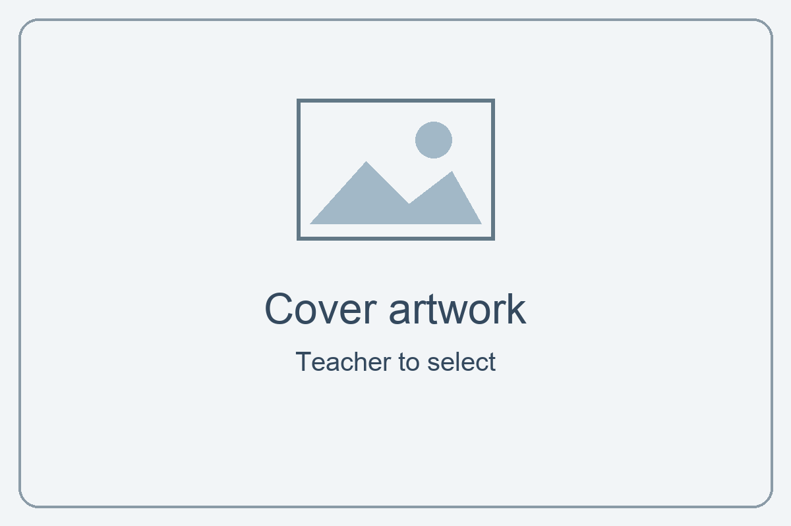

:::: layout-cover
::: cover-name
Student  
Name: ........................................
:::

::: cover-qualification
Level 1  
Ascentis Progression
:::

::: cover-code
Unit R/505/3062
:::

::: cover-title
# Imaging Software
:::

::: cover-artwork
{width="9cm"}
:::
::::

::: layout-cover-dates
| Issue Date | Hand in Date | IV Date | Teacher Name |
| :---: | :---: | :---: | :---: |
| | | | |
:::

::: layout-page-break
:::

## Learning Outcomes and Assessment Criteria

In order to pass this unit, the evidence that the learner presents for assessment needs to demonstrate that they can meet all the learning outcomes for the unit. The assessment criteria determine the standard required to achieve the unit.

::: layout-assessment-criteria
+---------------------------------------+---------------------------------------------------------------+
| Learning Outcome (The learner will:)  | Assessment Criteria (The learner can:)                        |
+=======================================+===============================================================+
| **1. Be able to obtain, insert and    | 1.1 Identify what images are needed.                          |
| combine information for images.**     |                                                               |
|                                       | 1.2 Obtain, input and prepare images to meet needs.           |
|                                       |                                                               |
|                                       | 1.3 Identify what generic copyright and other constraints     |
|                                       | apply to the use of images.                                   |
|                                       |                                                               |
|                                       | 1.4 Combine information of different types or from different  |
|                                       | sources for images.                                           |
|                                       |                                                               |
|                                       | 1.5 Identify the context in which the images will be used.    |
|                                       |                                                               |
|                                       | 1.6 Identify which file format to use for saving and          |
|                                       | exchanging images.                                            |
|                                       |                                                               |
|                                       | 1.7 Store and retrieve files effectively, in line with local  |
|                                       | guidelines and conventions where available.                   |
+---------------------------------------+---------------------------------------------------------------+
| **2. Be able to use imaging software  | 2.1 Use suitable tools and techniques to create images.       |
| tools to create, manipulate and edit  |                                                               |
| images.**                             | 2.2 Use appropriate tools and techniques to manipulate and    |
|                                       | edit images.                                                  |
|                                       |                                                               |
|                                       | 2.3 Check images meet needs, using IT tools and making        |
|                                       | corrections as necessary.                                     |
+---------------------------------------+---------------------------------------------------------------+
:::

::: layout-page-break
:::

## Your project: Make a poster for Kickstart

Unit R/505/3062 · Level 1 · 3 credits

### Your aim

Learn to collect, combine and edit images for a purpose, then save and check suitable files.

### Your brief

Advertise your Kickstart course to a prospective student. Show your own work and somebody else's work, with permission. Make an A4 portrait poster for a noticeboard and a smaller copy for a college information page.

### What to include

- Kickstart title, two teacher-checked facts and a useful next step.
- Your own work and another person's work, with sources recorded.
- Named layers, a group, text and imported images.
- A selection, edited mask, brush element and suitable filter.
- Checked PSD, print JPG and smaller web JPG or PNG.

### Useful links and starter resources

Open the [Photoshop guide](../l1-imaging-software-student/guides/guide-imaging-software.html), [starter brief](../l1-imaging-software-student/templates/kickstart-starter-brief.html) and [layout example](../l1-imaging-software-student/examples/poster-layout-example.html) from the resource pack. The guide links to [Adobe help](https://helpx.adobe.com/photoshop/desktop.html) and matches these task numbers.

Follow the full checklist in Task 8. Submit to your teacher; do not publish the poster yourself.

::: layout-page-break
:::

## Start here: a short practice

Use Guide Step 0. This is practice before your assessed poster.

1. Make an Imaging Software folder in your college OneDrive. Inside it, make originals, working, exports and evidence folders.
2. Open the supplied practice-background.png in Photoshop.
3. Use File → Place Embedded to add practice-camera.png. Confirm placement, then try moving and resizing it.
4. Try Undo. Rename both layers so you know what they contain.
5. Save a PSD called Firstname-Surname-Practice.psd in working. Close it, find the folder and reopen it.

### Quick check

Show your teacher the two layers. Hide one layer, then show it again. Which layer appears in front? Try swapping the order.

### Capture your evidence

Use Windows+Shift+S to capture the useful part of your screen. Paste into the matching evidence box. Check that text and layer names are readable; two small snippets are often better than a tiny whole screen.

Keep your PSD. Your teacher needs it to check editable layers and masks. Save after each task.

::: layout-page-break
:::

## Task 1: Plan your message

Assessment criteria: 1.1, 1.5. Use Guide Step 1.

1. Read the starter brief and explore the annotated example.
2. Think about your reader. What should they notice and do next?
3. Choose images of your own work and another person's work.

### Audience and purpose

::: {.layout-textbox height="3.5cm" title="My reader, message and two uses"}
Who is your reader? What should they learn? Explain where the print and screen copies will be used.
:::

### Images you need

Name an image for each role and explain how it helps your message.

+-------------------------+-------------------------------------------------------------------------+
| Image role              | What I need and why                                                     |
+=========================+=========================================================================+
| My own work             |                                                                         |
|                         |                                                                         |
| &nbsp;                  | &nbsp;                                                                  |
|                         |                                                                         |
| &nbsp;                  | &nbsp;                                                                  |
+-------------------------+-------------------------------------------------------------------------+
| Somebody else’s work    |                                                                         |
|                         |                                                                         |
| &nbsp;                  | &nbsp;                                                                  |
|                         |                                                                         |
| &nbsp;                  | &nbsp;                                                                  |
+-------------------------+-------------------------------------------------------------------------+

::: layout-page-break
:::

## Task 1 continued: Sketch your layout

Draw on paper and insert a photo, or use Word shapes in the space below. A rough plan is fine. No masterpiece required!

Label the headline, two images, course facts and next step. Leave clear space around important information. Choose a layout of your own.

::: {.layout-textbox height="8cm" title="My labelled poster plan"}
Sketch here, or insert a photo of your labelled plan.
:::

### One design choice

::: {.layout-textbox height="3.5cm" title="I will make this stand out because…"}
Name the most important part of your poster and explain how you will draw attention to it.
:::

::: layout-page-break
:::

## Task 2: Gather and check your images

Assessment criteria: 1.2, 1.3. Use Guide Step 2.

1. Obtain images of your work and somebody else's work. Keep unchanged originals in originals.
2. Check who made each image and whether your planned use is allowed. Ask before using another learner's work or photo.
3. Record each source and any required credit. A search result is not permission. Choose a different image if permission is unclear.

### My source and permission log

Use filenames so your teacher can match this log to your images. Add rows if needed. Do not record private contact details.

+------------------------+-------------------------------------+----------------------------------------+
| File / what it shows   | Creator and source / web address    | Permission, allowed use and credit     |
+========================+=====================================+========================================+
| My work:               |                                     |                                        |
|                        |                                     |                                        |
| &nbsp;                 | &nbsp;                              | &nbsp;                                 |
|                        |                                     |                                        |
| &nbsp;                 | &nbsp;                              | &nbsp;                                 |
+------------------------+-------------------------------------+----------------------------------------+
| Other person’s work:   |                                     |                                        |
|                        |                                     |                                        |
| &nbsp;                 | &nbsp;                              | &nbsp;                                 |
|                        |                                     |                                        |
| &nbsp;                 | &nbsp;                              | &nbsp;                                 |
+------------------------+-------------------------------------+----------------------------------------+
| Extra image:           |                                     |                                        |
|                        |                                     |                                        |
| &nbsp;                 | &nbsp;                              | &nbsp;                                 |
|                        |                                     |                                        |
| &nbsp;                 | &nbsp;                              | &nbsp;                                 |
+------------------------+-------------------------------------+----------------------------------------+
### Another constraint

::: {.layout-textbox height="3.5cm" title="A constraint and what I will do"}
Identify one other limit, such as privacy, a person’s consent, image quality or branding. Explain how you will deal with it.
:::

::: layout-page-break
:::

## Task 2 continued: Prepare useful copies

1. Open each image in Photoshop. Use Image → Image Size to check its pixel dimensions, then cancel the dialog.
2. Inspect at 100% zoom. Check that the important part is sharp and that private information is hidden or removed in a working copy.
3. Save prepared copies in working. Keep the originals unchanged.

### My preparation record

::: {.layout-textbox height="3.5cm" title="One image I prepared"}
Name the file and its pixel dimensions. Say how you obtained it, what you changed or checked, and why it is suitable.
:::

### Evidence of preparation

::: {.layout-textbox height="6.5cm" title="Prepared image and dimensions"}
Paste a readable snippet of your prepared image and its Image Size details. Your teacher can also check your original and prepared files.
:::

::: layout-page-break
:::

## Task 3: Build your poster with layers

Assessment criteria: 1.4, 2.1. Use Guide Step 3.

1. Create an A4 portrait document: 210 × 297 mm, 300 pixels/inch, RGB, 8-bit, sRGB.
2. Place your images as separate layers. Resize without stretching.
3. Add a background, Kickstart title, two checked course facts and an approved next step. Keep text editable.
4. Name your layers and put related layers in a group. Save your PSD in working.

### My combined information

::: {.layout-textbox height="3.5cm" title="What I combined"}
Name the image sources and the text you combined. Explain how one choice helps the reader.
:::

### Evidence of your composition

::: {.layout-textbox height="6.5cm" title="Poster and Layers panel"}
Show the poster, readable layer names and at least one group. Use two snippets if needed.
:::

::: layout-page-break
:::

## Task 4: Select and mask

Assessment criterion: 2.2. Use Guide Step 4.

1. Choose an image area to keep. Make a selection using a suitable tool.
2. Add a layer mask. Refine its edge using a black or white brush on the mask thumbnail.
3. Check at 100% zoom. Fix any missing edges or unwanted background, then save.

### My editing choice

::: {.layout-textbox height="3.5cm" title="Tool, change and reason"}
Name your selection tool. Explain one edge problem you fixed and how the mask helped.
:::

### Evidence of your mask

::: {.layout-textbox height="6.5cm" title="Before, after and mask thumbnail"}
Paste labelled before/after snippets and the mask thumbnail in Layers. Keep the editable mask in your PSD.
:::

::: layout-page-break
:::

## Task 5: Create and refine details

Assessment criteria: 2.1, 2.2. Use Guide Step 5.

1. Try hard and soft brushes in practice. Choose a useful brush element for your poster and paint on a new layer.
2. Apply a suitable Smart Filter to an image/background layer. Compare before and after; adjust its strength.
3. Check your text is readable and the effects support your message. Save your PSD.

### My tool choices

+----------------------+----------------------------------------------------------------------------+
| Tool                 | My settings and why they help                                              |
+======================+============================================================================+
| Brush                | Type, size and opacity:                                                    |
|                      |                                                                            |
| &nbsp;               | &nbsp;                                                                     |
|                      |                                                                            |
| &nbsp;               | &nbsp;                                                                     |
+----------------------+----------------------------------------------------------------------------+
| Smart Filter         | Filter name and setting:                                                   |
|                      |                                                                            |
| &nbsp;               | &nbsp;                                                                     |
|                      |                                                                            |
| &nbsp;               | &nbsp;                                                                     |
+----------------------+----------------------------------------------------------------------------+
### Evidence of your details

::: {.layout-textbox height="6.5cm" title="Brush layer and Smart Filter"}
Show your brush element on its own named layer and your filter listed under its image layer. Include brush settings, or demonstrate them to your teacher.
:::

::: layout-page-break
:::

## Task 6: Review and improve

Assessment criterion: 2.3. Use Guide Step 6.

1. Use Fit on Screen for the whole layout and 100% zoom for edges and detail. Check Image Size and your text.
2. Ask a partner what they notice first and what needs improving. Ask your teacher if no partner is available.
3. Use Photoshop tools to make two useful improvements. Fix other problems too. If you cannot spot a problem, ask for a review.

### Feedback and checks

::: {.layout-textbox height="3.5cm" title="My reviewer and checks"}
Name your reviewer and their suggestion. Record what you checked with 100% zoom and Image Size.
:::

### My improvements

+-----------------------------------+--------------------------+---------------------------------------+
| Before: what needed improving?    | Photoshop tool used      | After: what improved?                 |
+===================================+==========================+=======================================+
|                                   |                          |                                       |
|                                   |                          |                                       |
| &nbsp;                            | &nbsp;                   | &nbsp;                                |
|                                   |                          |                                       |
| &nbsp;                            | &nbsp;                   | &nbsp;                                |
+-----------------------------------+--------------------------+---------------------------------------+
|                                   |                          |                                       |
|                                   |                          |                                       |
| &nbsp;                            | &nbsp;                   | &nbsp;                                |
|                                   |                          |                                       |
| &nbsp;                            | &nbsp;                   | &nbsp;                                |
+-----------------------------------+--------------------------+---------------------------------------+
Short notes are enough. Your teacher can inspect the improved PSD or ask you to demonstrate a correction.

::: layout-page-break
:::

## Task 7: Choose formats and make copies

Assessment criteria: 1.6, 2.3. Use Guide Step 7.

1. Keep the layered PSD at its original size.
2. Save a high-quality print JPG at full size. Export a separate web JPG or PNG, 1000 pixels wide, with proportions linked.
3. Open both copies and inspect them. Check pixel dimensions, colour and readable text. Check the print copy is A4 at 300 ppi.

### My format choices

::: {.layout-textbox height="3.5cm" title="Formats and reasons"}
Why keep the PSD? Why is JPG suitable for your print copy? Which web format did you choose, and why?
:::

### My output checks

Record what you actually checked. If the result differs from the brief, correct it or record an agreed adjustment.

+---------------------+--------------------------------+-----------------------------------------------+
| Copy                | Pixel width × height           | Checks / correction                           |
+=====================+================================+===============================================+
| Print JPG           |                                |                                               |
|                     |                                |                                               |
| &nbsp;              | &nbsp;                         | &nbsp;                                        |
|                     |                                |                                               |
| &nbsp;              | &nbsp;                         | &nbsp;                                        |
+---------------------+--------------------------------+-----------------------------------------------+
| Web JPG/PNG         |                                |                                               |
|                     |                                |                                               |
| &nbsp;              | &nbsp;                         | &nbsp;                                        |
|                     |                                |                                               |
| &nbsp;              | &nbsp;                         | &nbsp;                                        |
+---------------------+--------------------------------+-----------------------------------------------+

::: layout-page-break
:::

## Task 7 continued: Check your print copy

Open the saved print JPG. Use Image → Image Size to inspect its width, height and resolution. Cancel after checking so you do not change it by accident.

::: {.layout-textbox height="6.5cm" title="Print copy: Image Size screenshot"}
Show A4 dimensions, 300 pixels/inch and approximately 2480 × 3508 pixels. Keep filename and settings readable.
:::

### Compare your copies

::: {.layout-textbox height="3.5cm" title="What I noticed"}
Compare the print and web files. Note their file sizes and one difference or similarity in how they look. Say whether they meet their intended uses.
:::

If either output needs a change, correct the PSD and make fresh copies. Keep the PSD at full size.

::: layout-page-break
:::

## Task 8: Retrieve and hand in

Assessment criterion: 1.7. Use Guide Step 8.

1. Save and close the PSD. Open your working folder, locate the file and reopen it.
2. Show your teacher an editable text layer and your mask. Save again.
3. Record your file locations. Use the checklist on the next page before handing in.

### Find my files

::: {.layout-textbox height="3.5cm" title="My folder and filenames"}
Record the folder and names for your PSD, print copy, web copy and booklet. Do not include passwords or private sharing links.
:::

### Retrieval demonstration

+------------------------------------------------------------------------+--------------------------+
| Teacher observation                                                    | Date / initials          |
+========================================================================+==========================+
| Learner located and reopened the correct PSD from their folder, showed |                          |
| editable content and saved it.                                         |                          |
+------------------------------------------------------------------------+--------------------------+
### Final thought

::: {.layout-textbox height="3.5cm" title="My reflection"}
What helps your reader most? What would you improve next time? One short sentence for each is enough.
:::

::: layout-page-break
:::

## Task 8 continued: Final checklist

Check your actual files before ticking. If you change the PSD, make and check fresh print and web copies.

+----------------------------------------------------------------------------------------+----------+
| Requirement                                                                            | Done?    |
+========================================================================================+==========+
| Kickstart title, two checked facts and an approved next step                           |          |
+----------------------------------------------------------------------------------------+----------+
| Own work and another person’s work; sources and permissions recorded                   |          |
+----------------------------------------------------------------------------------------+----------+
| Audience, image needs, two contexts and layout plan completed                          |          |
+----------------------------------------------------------------------------------------+----------+
| Named layers, group, editable text and separate imported images                        |          |
+----------------------------------------------------------------------------------------+----------+
| Selection and refined editable mask                                                    |          |
+----------------------------------------------------------------------------------------+----------+
| Brush element on its own layer; settings recorded                                      |          |
+----------------------------------------------------------------------------------------+----------+
| Suitable Smart Filter; reason recorded                                                 |          |
+----------------------------------------------------------------------------------------+----------+
| Feedback, tool-based checks and two improvements recorded                              |          |
+----------------------------------------------------------------------------------------+----------+
| Full-size PSD; print JPG and smaller web JPG/PNG checked                               |          |
+----------------------------------------------------------------------------------------+----------+
| PSD retrieved; booklet evidence and declaration complete                               |          |
+----------------------------------------------------------------------------------------+----------+
### Hand in

Submit your PSD, print image, web image and completed booklet. Keep originals and permission records available for your teacher. Hand in originals only if requested and allowed.

Teacher: class hand-in location _________________________________

::: layout-page-break
:::

## Assessor record

Check the PSD, outputs, booklet and any demonstration. Record a file/page/task or dated observation. Identify further action if needed.

+-------------+---------+--------------------------------------------------------------------------+
| Criterion   | Met?    | Evidence location / further action                                       |
+=============+=========+==========================================================================+
| 1.1         |         |                                                                          |
+-------------+---------+--------------------------------------------------------------------------+
| 1.2         |         |                                                                          |
+-------------+---------+--------------------------------------------------------------------------+
| 1.3         |         |                                                                          |
+-------------+---------+--------------------------------------------------------------------------+
| 1.4         |         |                                                                          |
+-------------+---------+--------------------------------------------------------------------------+
| 1.5         |         |                                                                          |
+-------------+---------+--------------------------------------------------------------------------+
| 1.6         |         |                                                                          |
+-------------+---------+--------------------------------------------------------------------------+
| 1.7         |         |                                                                          |
+-------------+---------+--------------------------------------------------------------------------+
| 2.1         |         |                                                                          |
+-------------+---------+--------------------------------------------------------------------------+
| 2.2         |         |                                                                          |
+-------------+---------+--------------------------------------------------------------------------+
| 2.3         |         |                                                                          |
+-------------+---------+--------------------------------------------------------------------------+
Decision: [ ] Pass  [ ] Resubmission required

Assessor name: ____________________  Date: ____________________

Assessor signature: ____________________

::: layout-page-break
:::

## Student declaration of authenticity

::: layout-declaration
I confirm that this poster and booklet are my own work. I have recorded the images and other sources I used, and any help I received.

[ ] I confirm this is my own authentic work.

Learner name: ______________________________________

Learner ID: ________________________________________

Date: _____________________________________________

Signature: ________________________________________
:::
